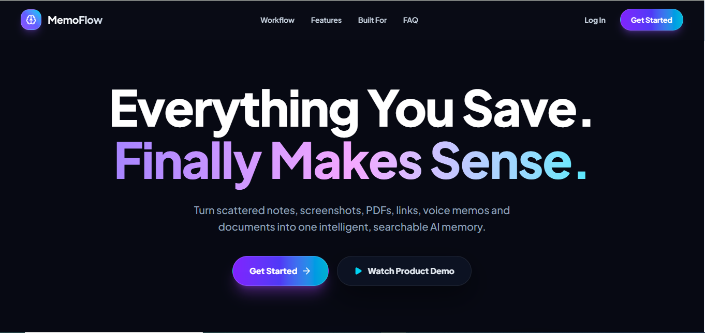
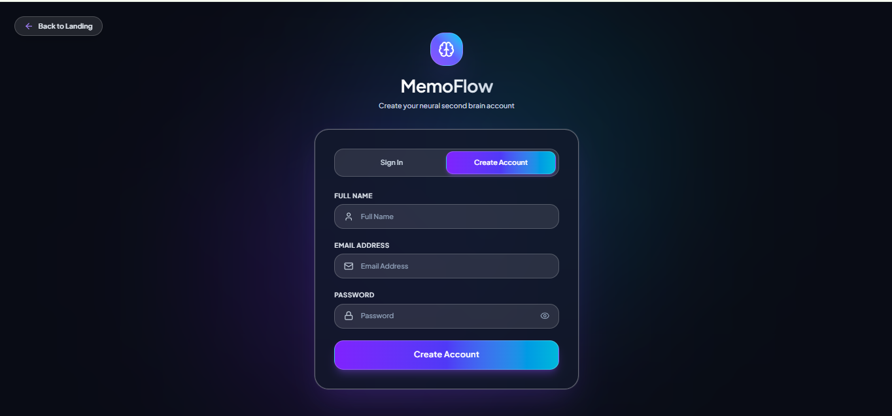
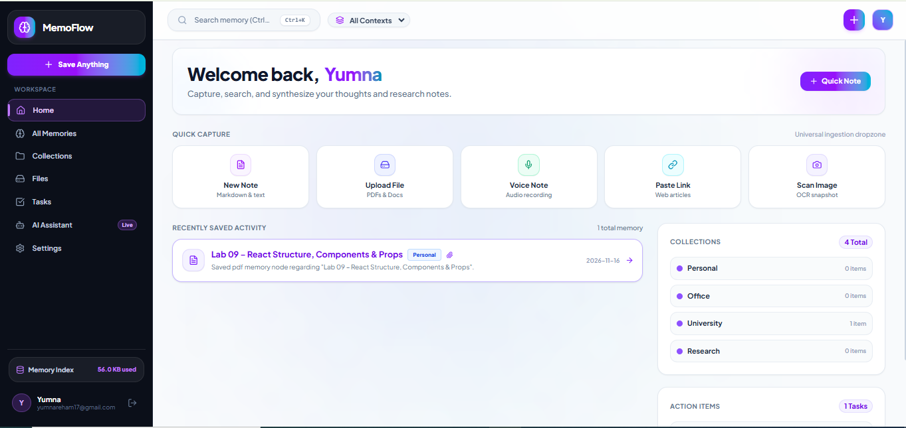
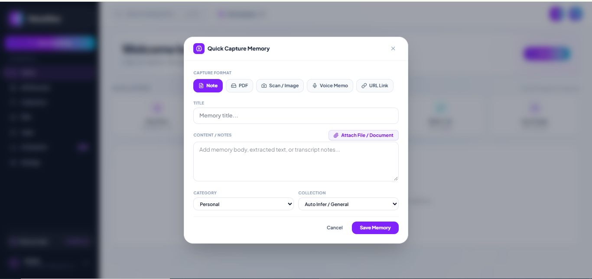
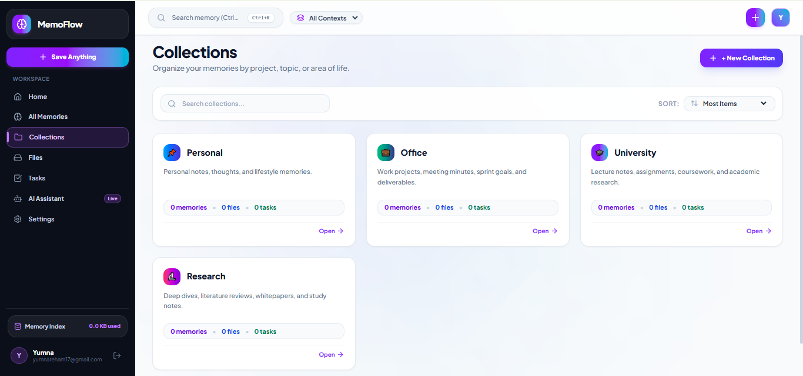
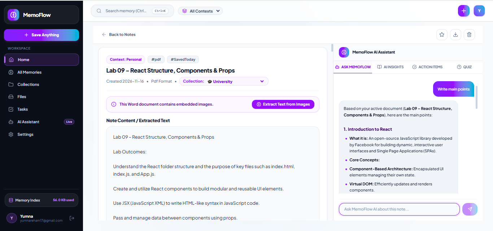
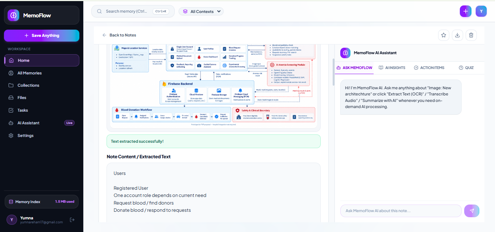
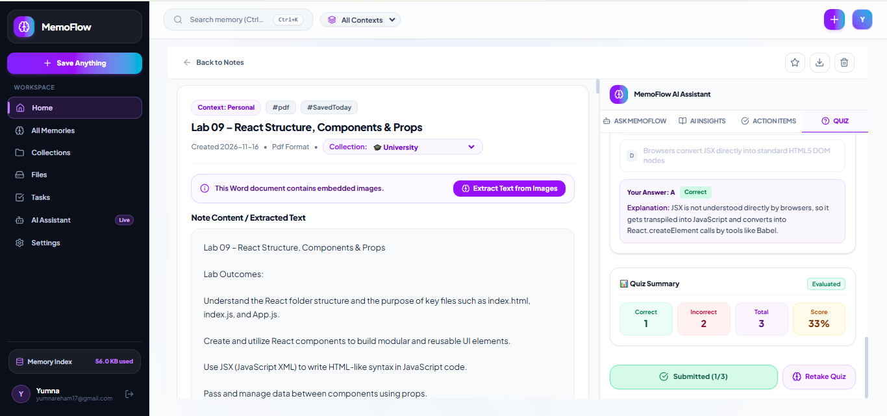
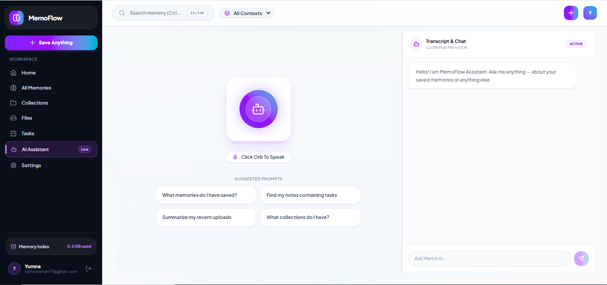
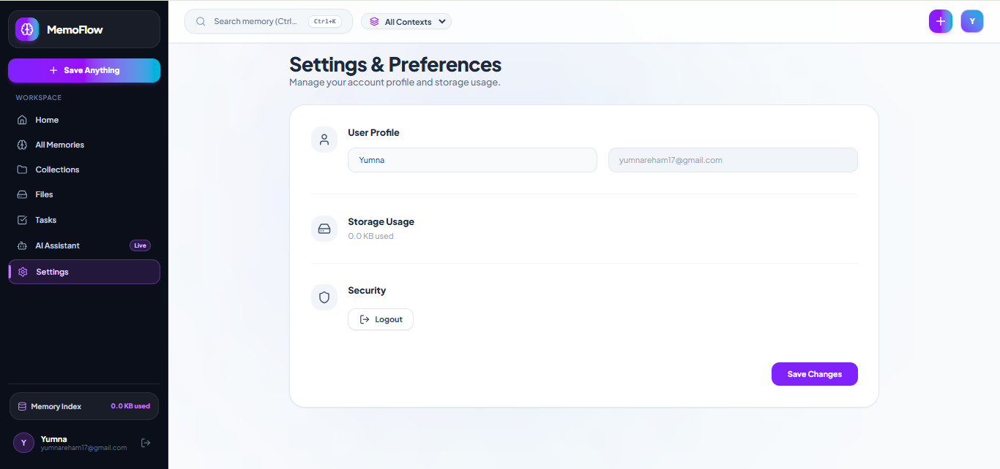

# MemoFlow AI

### AI-Powered Personal Memory & Knowledge Workspace

MemoFlow AI is a full-stack personal project that brings notes, documents, images, voice memos, and web resources into one intelligent workspace.

It helps users organize information, generate AI-powered insights, and interact with their saved knowledge through a personalized AI assistant.

## Application Screenshots

A look at MemoFlow AI's interface and core functionality.

## Key Features

### Knowledge Management
- Create, edit, and organize persistent notes.
- Upload PDF, DOCX, and image files.
- Extract text from images and handwritten notes using OCR.
- Upload voice memos with transcription support.
- Capture and process content from supported web URLs.
- Organize information using collections, tags, and tasks.

### AI-Powered Capabilities
- **AI Memory Assistant:** Ask questions about saved knowledge or general topics.
- **Context-Aware Retrieval:** Generate answers using relevant stored information.
- **AI Summarization:** Generate summaries, key takeaways, and action items.
- **AI Quiz Generator:** Create interactive quizzes and review scores.
- **Content Processing:** Analyze information extracted from documents, images, audio, and web resources.

### User Experience
- Responsive, modern dashboard.
- Quick search with `Ctrl + K`.
- User authentication and persistent storage.
- Personalized workspace for managing digital knowledge.

## Tech Stack

| Category | Technologies |
|---|---|
| Frontend | Next.js 16, React 19, TypeScript |
| Styling | Tailwind CSS, Framer Motion |
| Backend | Next.js API Routes |
| Database | Supabase PostgreSQL |
| Authentication & Storage | Supabase Auth, Supabase Storage |
| AI Integration | Google Gemini API |
| Document Processing | PDF Parse, Mammoth |
| OCR | Tesseract.js |
| UI & Visualization | Lucide React, Recharts |

## Security & Privacy

- Local environment files are excluded from Git.
- Supabase authentication and Row Level Security are used for data access.
- Private credentials must remain in environment variables.
- API authorization and database policies should be reviewed before public deployment.

## Project Status

Personal portfolio project with core knowledge management and AI features implemented. Further improvements and deployment configuration are ongoing.

## Author

Developed by [Yumna-Reham](https://github.com/Yumna-Reham).